# Procesverslag
Markdown is een simpele manier om HTML te schrijven.  
Markdown cheat cheet: [Hulp bij het schrijven van Markdown](https://github.com/adam-p/markdown-here/wiki/Markdown-Cheatsheet).

Nb. De standaardstructuur en de spartaanse opmaak van de README.md zijn helemaal prima. Het gaat om de inhoud van je procesverslag. Besteedt de tijd voor pracht en praal aan je website.

Nb. Door *open* toe te voegen aan een *details* element kun je deze standaard open zetten. Fijn om dat steeds voor de relevante stuk(ken) te doen.

Mijn site: https://jozua3.github.io/FED-Website/

## Jij

  
uitwerken voor kick-off werkgroep

  ### Auteur:
  Jozua Kroeze

  #### Je startniveau:
  Blauw

  #### Je focus:
  Responsive 
 

## Je website

  
uitwerken voor kick-off werkgroep

  ### Je opdracht:
  link naar de website die je gaat namaken: https://saltmurphy.com

  #### Screenshot(s) van de eerste pagina (small screen): 
  Home 
  

  #### Screenshot(s) van de tweede pagina (small screen):
  Autumn/ Winter 2026  
  
 

## Toegankelijkheidstest 1/2 (week 1)

  
uitwerken na test in 2e werkgroep

  ### Bevindingen
  Lijst met je bevindingen die in de test naar voren kwamen:
  1 navbar is niet duidelijk, het contrast met de afbeelding erachtr is groot genoeg.

  #### Content
  Content
  Er is geen simpele naam voor de elementen dus met een voice-over kan dat verwarrend zijn.

  #### Global code 
  DE site is niet dooor de validater heen gekomen, er staan best veel errors in. Vooral in de CSS waarin onderdelen verkeerd benoemt zijn
  #### Keyboard
  Alleen op het element waar je kan abboneren op het krijgen van updates over de site, is er een duidlijke focs. bij de rest zie je alleen focus van laptopsysteem zelf 
  #### Mobile and touch 
  De mobiele website den de website voor de desktop verschillen que de afbeeldingen op de homepage. Ook de indeling van de overige items is anders maar dat komt door de formaten waar de site zich aan aanpast. 
  #### Headings
  De sote heeft geen namen voor de headings, ook zie ik geen "h1" maar die kunnen verborgen zijn. Er wordt vooral "div" gebruikt. Wat echt opviel is dat er een skop-link is die je direct naar de content leidt. 
  #### Lijst
  Er worden voornamelijk "div" gebruikt, op de website. He kan hier ook zijn dat het in een div staat en zo anders is vormgegeven.
  #### Images 
  De afbeeldingen zijn wel te zien op de site, maar in de html is het noelijker te zien, Omdat best een groot deel verborgen is.
  #### Media Viedeo and Audio
  De site maakt geen gebruik van video of Audio
  #### Controls
  Op de site is er vooral gebruik gemaakt van span-id of div waardoor het moeilik te zien is. In de code of de a-attributen juist gebruikt worden.
  #### Appearance
  De letterypes die worden gebruikt en de kleuren maken het moeilijk om de tekst te lezen die op de afbeeldingen staat. Ook de funcites die er voor zorgen om de tekst makkelijk leesbaar te maken zijn er niet. 
  #### Animation
  De animaties staan alleen op de afbeeldingen vn de producten  die je kan kopen. Die zijn wel goed te volgen. 
  #### Color contrast
  De site gebruikt op elke pagina dezelfde keleuren en varieerd winig met tekst. Waardoor je weinig/ niet goed kan zien als je bijvoorbeeld slechtziend bent. De achtergrondafbeelding bestaat ook redelijk uit dezelfde keleuren als de tekst, waardooor de tekst op sommige gebieden wegvalt. 

## Breakdownschets (week 1)

  
uitwerken na afloop 3e werkgroep

  ### de hele pagina: 
  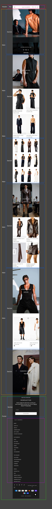
  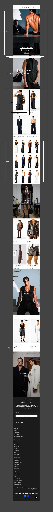

  ### dynamisch deel (bijv menu): 
  

  ### wellicht nog een dynamisch deel (bijv filter): 
  

## Voortgang 1 (week 2)

  
uitwerken voor 1e voortgang

  ### Stand van zaken
  hier dit ging goed & dit was lastig (neem ook screenshots op van delen van je website en code)

  Het maken van een hamburger menu vond ik op het begin lastig. Ik heb uiteindelijk zelf een tutorial opgezocht op youtube en aan de hand daarvaan eentje gemaakt
  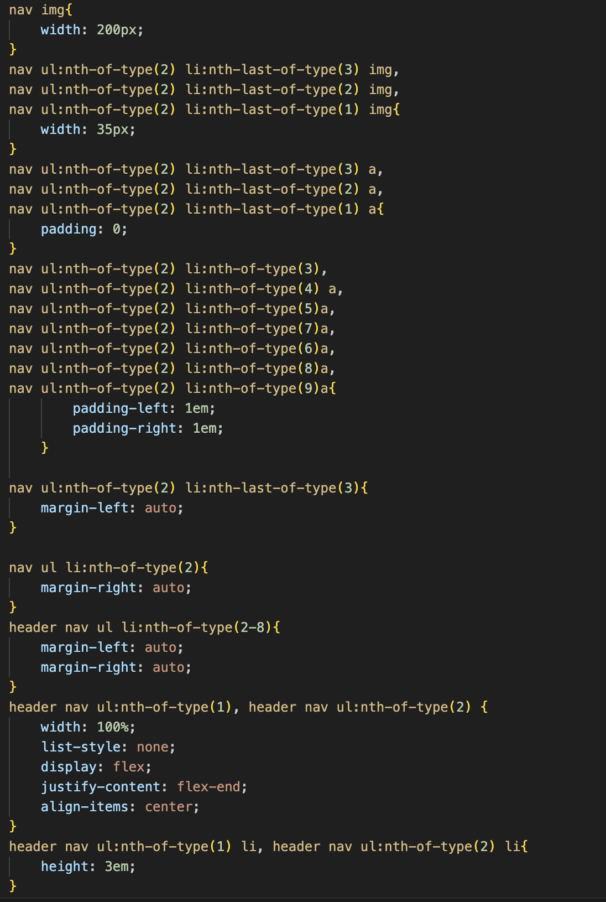
  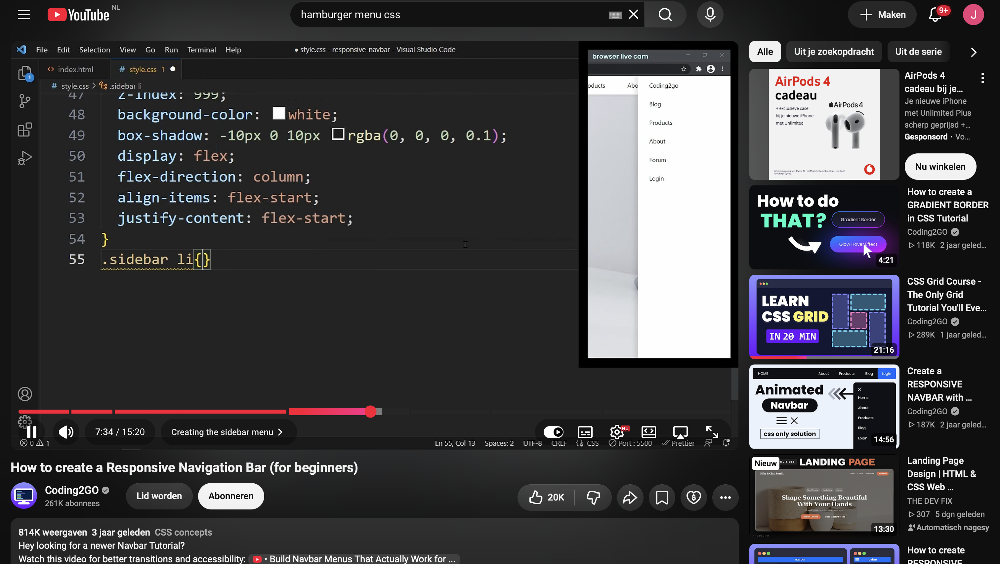
  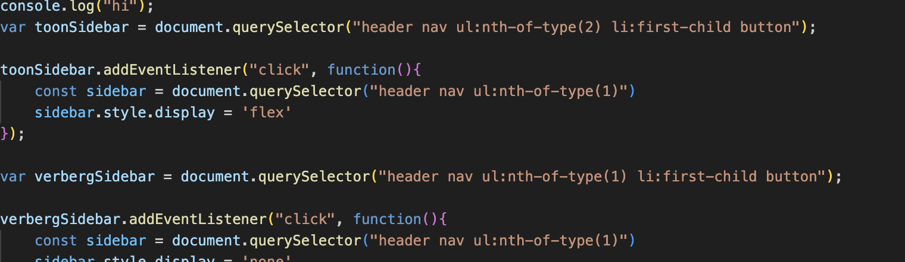

  ook kwam ik gaande weg achter dat mijn breakdownschet toch net helemaal handig of juist was. dus gaande weg heb ik dingen ook aangepst. 

  ### Agenda voor meeting
  samen met je groepje opstellen

  | student 1      | student 2          | student 3    | student 4        |
  | ---            | ---                | ---          | ---              |
  | dit bespreken  | en dit             | en ik dit    | en dan ik dat    |
  | en dat ook nog | dit als er tijd is | nog een punt | dit wil ik zeker |
  | ...            | ...                | ...          | ...              |

  ### Verslag van meeting
  hier na afloop snel de uitkomsten van de meeting vastleggen

  - punt 1
  - punt 2
  - nog een punt
  - ...

## Voortgang 2 (week 3)

  
uitwerken voor 2e voortgang

  ### Stand van zaken
  hier dit ging goed & dit was lastig (neem ook screenshots op van delen van je website en code)
  Het werken met grid was iets dat ik weer even onder de knie moest krijgen, het ging niet altijd goed. als ik er zelf echt niet uitwam ging ik op internet kijken hoe het kan of aan ChatGPT vragen of die mij met dat onderdeel kon helpen. 

  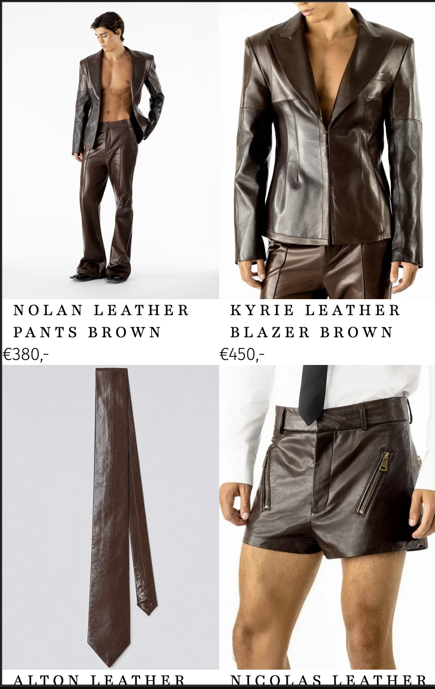
   
  

  ### Agenda voor meeting
  samen met je groepje opstellen

  | student 1      | student 2          | student 3    | student 4        |
  | ---            | ---                | ---          | ---              |
  | dit bespreken  | en dit             | en ik dit    | en dan ik dat    |
  | en dat ook nog | dit als er tijd is | nog een punt | dit wil ik zeker |
  | ...            | ...                | ...          | ...              |

  ### Verslag van meeting
  hier na afloop snel de uitkomsten van de meeting vastleggen

  - punt 1
  - punt 2
  - nog een punt
- ...

## Toegankelijkheidstest 2/2 (week 4)

  
uitwerken na test in 9e werkgroep

  ### Bevindingen
  Lijst met je bevindingen die in de test naar voren kwamen (geef ook aan wat er verbeterd is):
  Er is geen simpele naam voor de elementen, met voice-over kan dat verwarrend zijn. Ik heb zelf an de links en buttens een aria-label gegeven. ook heb ik de font groter gemaakt dan gebruikelijk zodat het duidelijker te lezen is.
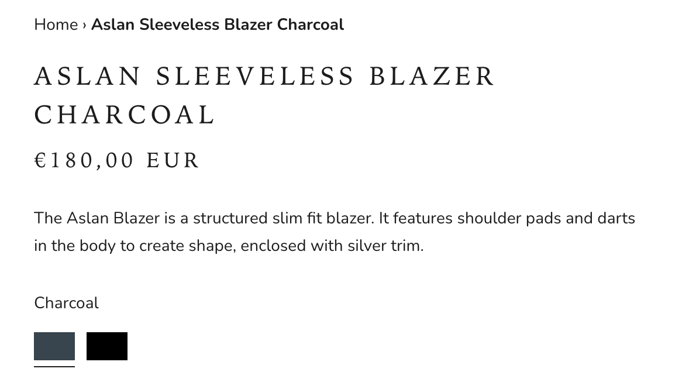
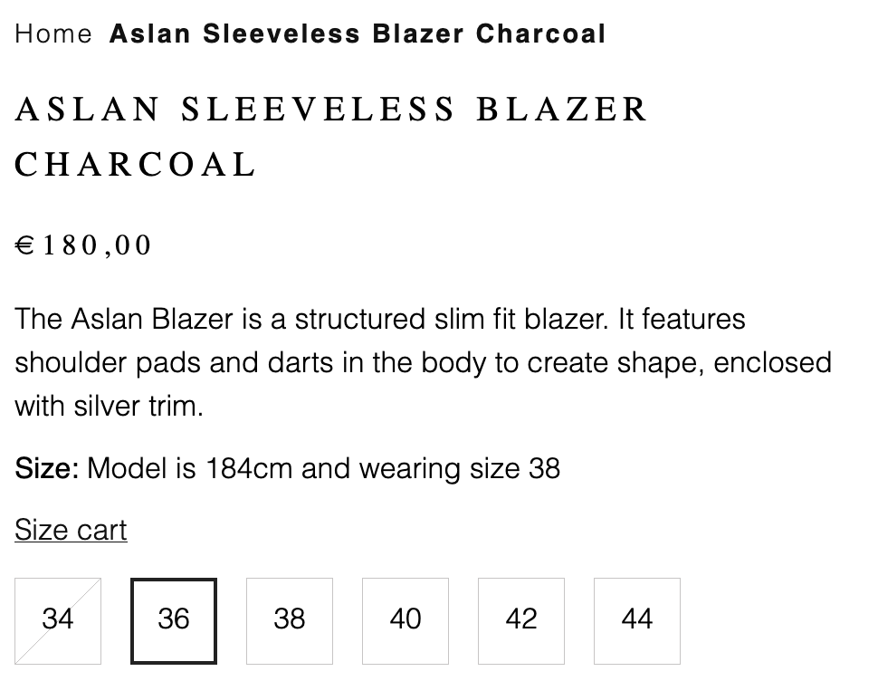

## Voortgang 3 (week 4)

  
uitwerken voor 3e voortgang

  ### Stand van zaken
  hier dit ging goed & dit was lastig (neem ook screenshots op van delen van je website en code)

  ### Agenda voor meeting
  samen met je groepje opstellen

  | student 1      | student 2          | student 3    | student 4        |
  | ---            | ---                | ---          | ---              |
  | dit bespreken  | en dit             | en ik dit    | en dan ik dat    |
  | en dat ook nog | dit als er tijd is | nog een punt | dit wil ik zeker |
  | ...            | ...                | ...          | ...              |

  ### Verslag van meeting
  hier na afloop snel de uitkomsten van de meeting vastleggen

  - punt 1
  - punt 2
  - nog een punt
  - ...

## Eindgesprek (week 5)

  
uitwerken voor eindgesprek

  ### Je uitkomst - karakteristiek screenshots:
  

  ### Dit ging goed/Heb ik geleerd: 
  Korte omschrijving met plaatjes

  

  ### Dit was lastig/Is niet gelukt:
  Korte omschrijving met plaatjes

  

## Bronnenlijst

  
continu bijhouden terwijl je werkt

  Nb. Wees specifiek ('css-tricks' als bron is bijv. niet specifiek genoeg). 
  Nb. ChatGpT en andere AI horen er ook bij.
  Nb. Vermeld de bronnen ook in je code.

  1. DETAIL https://www.w3schools.com/tags/tag_details.asp 
  2. CAHATGPT MAATSELECHTIE 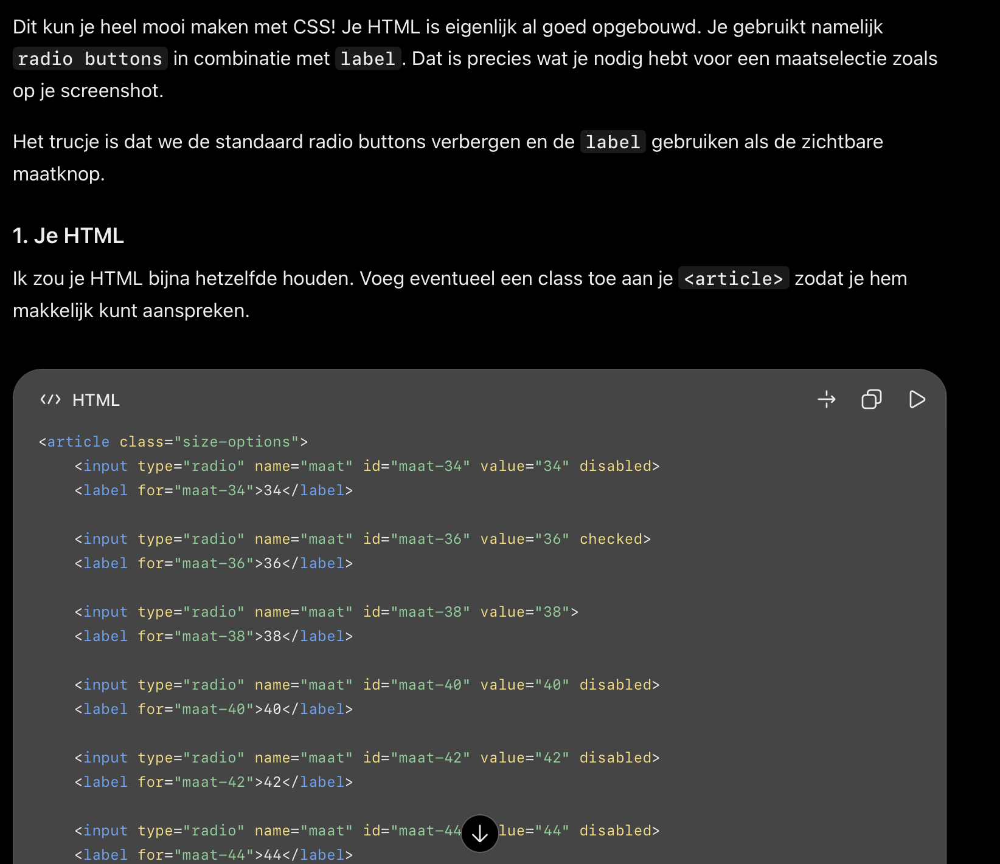 
    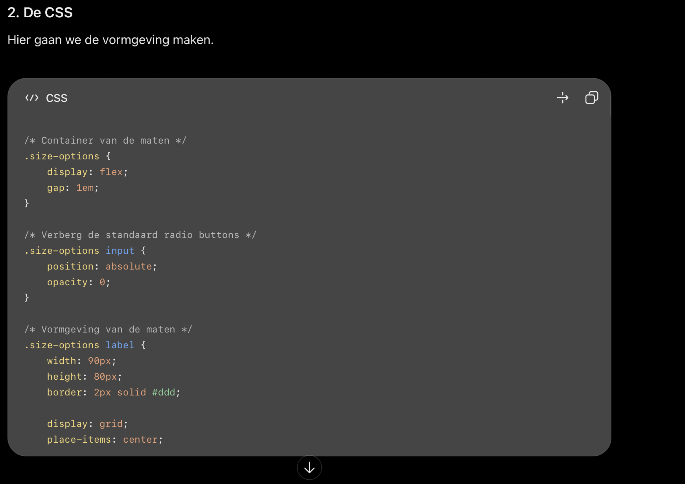
    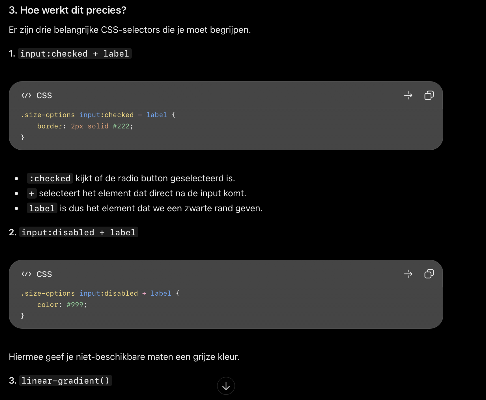
  3. MAKEN VAN GRID https://www.youtube.com/watch?v=JYfiaSKeYhE&t=495s

</details